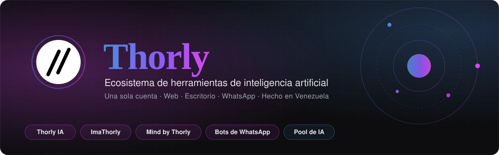
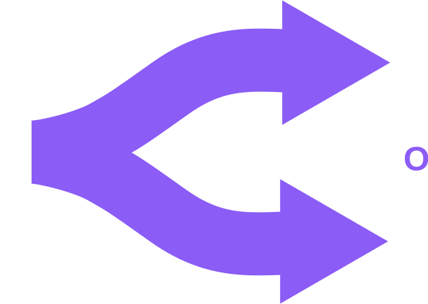
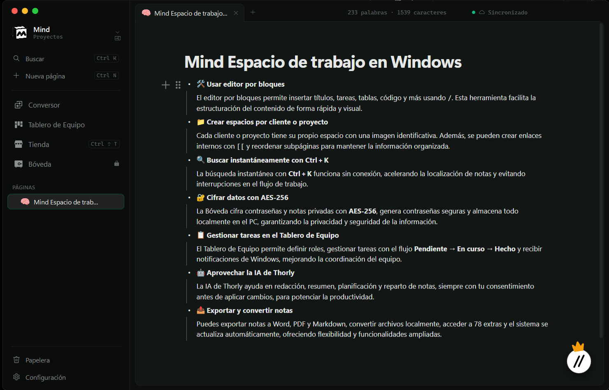

 

# Herramientas de IA para trabajar mejor

**Thorly es un ecosistema que crece contigo: en la web, en tu escritorio y en tus conversaciones.**

 

`Explora sin cuenta` &nbsp;·&nbsp; `Varios modelos de IA` &nbsp;·&nbsp; `Web, escritorio y WhatsApp`

**[thorly.dev](https://thorly.dev)** &nbsp;·&nbsp; **[Documentación](https://thorly.dev/docs.html)** &nbsp;·&nbsp; **[Portafolio del creador](https://thorly.dev/portafolio.html)**

> [!NOTE]
> Este repositorio es la **presentación pública** del ecosistema Thorly. No contiene código fuente: sirve para conocer qué es Thorly, qué productos ofrece y cómo empezar. Todo lo que ves aquí funciona en **[thorly.dev](https://thorly.dev)**.

---

## Impulsado por los mejores modelos y buscadores

<table>
<tr>
<td align="center" width="16%"> Groq</td>
<td align="center" width="16%"> Gemini</td>
<td align="center" width="16%"> OpenRouter</td>
<td align="center" width="16%"> Tavily</td>
<td align="center" width="16%"> You.com</td>
<td align="center" width="16%"> LangSearch</td>
</tr>
</table>

---

## Productos

<table>
<tr>
<td width="50%" valign="top">

### Thorly IA
`Web` · `Gratis`

Asistente multimodal para **conversar, razonar, programar y buscar en la web**.

- Razonamiento profundo
- Búsqueda con fuentes
- Código y diagramas
- Imágenes y PDF

**[Entrar a Thorly IA →](https://thorly.dev/thorly-ia.html)**

</td>
<td width="50%" valign="top">

### ImaThorly
`Salud` · `Licencia`

Redacción de **informes radiológicos** con IA.

- Dictado por voz
- Plantillas por tipo de estudio
- Editor visual listo para imprimir

**[Entrar a ImaThorly →](https://thorly.dev/imathorly.html)**

</td>
</tr>
<tr>
<td width="50%" valign="top">

### Mind
`Windows` · `v0.10.1` · `23 MB`

**Documentación, proyectos y tareas** con páginas enlazadas, guardadas en tu propio PC.

- Editor por bloques y buscador sin conexión
- Tablero de tareas del equipo
- Bóveda cifrada para contraseñas
- IA especializada que no cambia nada sin tu permiso

**[Descargar o ver detalles →](https://thorly.dev/mind.html)**

</td>
<td width="50%" valign="top">

### Bots de WhatsApp
`Negocios`

Un **agente de IA que atiende a tus clientes 24/7** desde el WhatsApp de tu negocio.

- Responde preguntas frecuentes
- Consulta inventario
- Deriva a una persona cuando hace falta

**[Solicitar demo →](https://thorly.dev)**

</td>
</tr>
</table>

 Mind by Thorly, el espacio de trabajo para Windows.

---

## Ecosistema

| | |
|---|---|
| 🔑 **Una cuenta para todo** | Un solo inicio de sesión para Thorly IA, ImaThorly y Mind. |
| 🧠 **Varios modelos** | Thorly elige el más adecuado para cada tarea y cambia de modelo si uno falla. |
| 📍 **Donde trabajes** | Navegador, app instalable, escritorio de Windows y WhatsApp. |
| 🔒 **Privado por diseño** | Acceso protegido por cuenta y claves que nunca se guardan en claro. |

---

## Empieza gratis hoy

1. Entra a **[thorly.dev](https://thorly.dev)** y explora sin cuenta.
2. Cuando quieras, **crea tu cuenta** con Google o con tu correo.
3. Usa la misma cuenta en la web, en Mind y en lo que venga.

---

## Contacto

Para licencias de ImaThorly, demos de bots de WhatsApp o cualquier consulta, escribe desde **[thorly.dev](https://thorly.dev)** (sección *Contacto*).

 

**Thorly** · Un ecosistema hecho en Venezuela · © 2026 Thorly. Todos los derechos reservados.

Thorly, ImaThorly, Mind by Thorly, thorly.dev y sus logotipos son marcas de su autor. Las marcas de terceros pertenecen a sus respectivos dueños.

